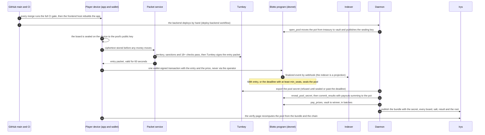

# Reviewing Blotto Cup

For hackathon judges, security reviewers and auditors. Every section here links to the code or the
document that owns its subject; nothing on this page is canonical. Where this page and the code
disagree, the code is right. The full document map is [`docs/README.md`](docs/README.md).

**Status, before anything else:** devnet only, no real money, no independent audit yet. See
[§6](#6-status).

## 1. What to read first

Ten files, in the order a pool lives through them. Together they cover where the money moves,
what decides who is paid, and how a player checks it.

| # | File | Why it matters |
|---|---|---|
| 1 | [`programs/blotto_cup/src/lib.rs`](programs/blotto_cup/src/lib.rs) | Every instruction the program has, and the two invariants that outrank any instruction added later. Every transfer goes through [`vault.rs`](programs/blotto_cup/src/vault.rs) |
| 2 | [`programs/blotto_cup/src/instructions/open_pool.rs`](programs/blotto_cup/src/instructions/open_pool.rs) | The fixed prize pool moves from the treasury into the pool's vault before a single entry exists. Only the keeper may open a pool |
| 3 | [`programs/blotto_cup/src/instructions/register.rs`](programs/blotto_cup/src/instructions/register.rs) | One entry in one transaction: verify the signed entry packet, take the price into the treasury, draw the cosmetic class, mint the frozen pass. Only `sha256(battles ‖ salt)` reaches the chain |
| 4 | [`programs/blotto_cup/src/instructions/reveal_commit.rs`](programs/blotto_cup/src/instructions/reveal_commit.rs) | The pool's secret goes on chain, hash-checked against the commitment made at open. The payout list must sum exactly to the pot |
| 5 | [`programs/blotto_cup/src/instructions/pay_prizes.rs`](programs/blotto_cup/src/instructions/pay_prizes.rs) | Vault to winner, batched by seat over the committed list. The settlement signer chooses only the batching |
| 6 | [`programs/blotto_cup/src/instructions/refund.rs`](programs/blotto_cup/src/instructions/refund.rs) | A pool that misses its minimum field refunds every entry in full. Both steps are permissionless, so a vanished operator strands nothing |
| 7 | [`backend/scoring/src/engine.ts`](backend/scoring/src/engine.ts) | All-vs-all scoring in integer half-points. The same module runs in settlement and in the browser (decision `R20`) |
| 8 | [`backend/reveal/src/crank.ts`](backend/reveal/src/crank.ts) | Settlement end to end: export the secret, reveal, score, screen winners, commit, pay, publish. Resumable from chain state |
| 9 | [`backend/sealing/src/custody-turnkey.ts`](backend/sealing/src/custody-turnkey.ts) | Each pool's sealing secret is export-locked in Turnkey until the pool is sealed or past its deadline, and the limits of that, stated |
| 10 | [`app/src/verify/logic.ts`](app/src/verify/logic.ts) | The verify page: recomputes a whole pool from the published bundle and the chain, and turns red if any number differs |

For the reasoning behind any of it, [`docs/architecture/DECISIONS.md`](docs/architecture/DECISIONS.md)
resolves every decision ID a comment cites.

## 2. Architecture in one picture

One pool, from deployment to verification. Derived from
[Figure 1 (trust boundaries)](docs/architecture/DIAGRAMS.md#figure-1--trust-boundaries) and
[Figure 8 (deploying and operating)](docs/architecture/DIAGRAMS.md#figure-8--deploying-and-operating);
the as-built description is [`docs/architecture/ARCHITECTURE.md`](docs/architecture/ARCHITECTURE.md).

What the picture shows, with the file that holds each property:

- **The payment never enters the operator zone.** The wallet signs one transaction straight to the
  program ([`app/src/entry/services.ts`](app/src/entry/services.ts)). The packet service can refuse
  an entry; it cannot take money.
- **The packet service is the entry gate, and it fails closed** — no vendor answer means no entry
  ([`backend/packet/src/main.ts`](backend/packet/src/main.ts)).
- **The daemon cannot read a board early.** The ciphertext is sealed to a key whose secret Turnkey
  will not export before the pool is sealed or past its deadline.
- **Publication comes after payment**, deliberately: a storage vendor that is down must not freeze a
  sealed pool's prize. A bundle still owed is published on a later tick.

## 3. Mobile

The Android app is the same site in a signed shell; the only new code path is the Mobile Wallet
Adapter wallet.

- [`docs/guide/MOBILE.md`](docs/guide/MOBILE.md) — what differs on a phone (§2), building and signing
  the package (§3–§4), testing on an emulator or a phone (§5), and known limitations (§9).
- [`mobile/README.md`](mobile/README.md) and [`mobile/patch-shell.sh`](mobile/patch-shell.sh) — the
  shell and the patches applied to the generated project.
- [`app/src/wallet/mobile-wallet.tsx`](app/src/wallet/mobile-wallet.tsx) — the Mobile Wallet Adapter
  registration; nothing downstream of the wallet registry changes.
- [`docs/testing/MOBILE-E2E.md`](docs/testing/MOBILE-E2E.md) — the devnet run on a device, with
  its entry signature, pool PDA and outcome. That pool refunded rather than settled, so no verify
  run from the phone is on record yet.

## 4. Security

- [`docs/security/SECURITY-REVIEW.md`](docs/security/SECURITY-REVIEW.md) — the reviews performed, the
  threat model, the on-chain invariants and how each is enforced, findings fixed and items still open.
- [`docs/security/SCANNER-TRIAGE-2026-10-11.md`](docs/security/SCANNER-TRIAGE-2026-10-11.md) — the
  verdict, evidence and fix for each of the 137 items in the automated security report supplied with
  the Solana hackathon, with a dated re-check of every lockfile.
- [`scripts/check-standing-rules.sh`](scripts/check-standing-rules.sh) — CI asserts the vault's exact
  set of lamport exits, that class is read by nothing in the scoring path, and the PDA seed rules.
- [`docs/architecture/adr/`](docs/architecture/adr/) — the program's threat mitigations
  (`threat-tm-401` to `threat-tm-403`, `threat-tm-502`) and the design records for the class draw and
  the pass.
- [`SECURITY.md`](SECURITY.md) — how to report a vulnerability.

The value the app keeps in browser storage under `blotto:device-salt:v3` is a random salt for an
anti-abuse device marker, not key material: no Solana private key is ever written to browser, WebView
or app storage, and [`app/src/entry/no-key-material.test.ts`](app/src/entry/no-key-material.test.ts)
holds that line in CI.

## 5. Why players come back

What is built today, each with the file that implements it. Retention here runs on mastery and
standing; nothing below changes how a pool is scored or who is paid.

| Mechanic | What the player sees | Where |
|---|---|---|
| A new pool after every pool | Each mode and tier runs its pools in sequence: when one is paid or closed, the keeper opens the next after a five-minute cooldown | [`open_pool.rs`](programs/blotto_cup/src/instructions/open_pool.rs), [`constants.rs`](programs/blotto_cup/src/constants.rs) |
| Two modes | Easy (100 points in each battle) and hard (700 across the board), each with its own pools. Which tiers and modes are open is an owner decision (`R6`) | [`backend/scoring/src/allocation.ts`](backend/scoring/src/allocation.ts) |
| The verified ranking of each pool | Every player's rank in a settled pool, served only from a bundle that verified | [`backend/indexer/src/read-api.ts`](backend/indexer/src/read-api.ts) (`GET /pools/:pool/leaderboard`) |
| What finished above you | After a pool, the board that ranked above the player's, battle by battle | [`app/src/results/what-beat-you.ts`](app/src/results/what-beat-you.ts), [`what-beat-you-panel.tsx`](app/src/app/pools/%5Bpool%5D/results/what-beat-you-panel.tsx) |
| A profile | A lifetime record (pools entered, seats paid, total won) and previous finishes with each pool's verified rank. The class is shown nowhere on it | [`profile-client.tsx`](app/src/app/profile/profile-client.tsx), [`finishes.tsx`](app/src/components/profile/finishes.tsx) |
| A result card to share | An image of one player's finish in one pool | [`app/src/app/card/[pool]/[player]/route.tsx`](app/src/app/card/%5Bpool%5D/%5Bplayer%5D/route.tsx) |
| One message when a pool ends | A wallet-signed, per-pool opt-in: one message about that pool, then the address is deleted. No schedule, no second message | [`backend/packet/src/notify-pool.ts`](backend/packet/src/notify-pool.ts) |

The operator also measures whether players return, in aggregate only — first-time versus repeat
paid seats and entries per wallet ([`backend/indexer/src/player-history.ts`](backend/indexer/src/player-history.ts)).

**Not built:** seasons, a ranking across pools, and rewards for activity of any kind. No class
carries any reward. Engagement-pressure mechanics are refused outright: their vocabulary is the
third group of the language gate ([`scripts/check-language.sh`](scripts/check-language.sh),
`PATTERN_D3`), so the words cannot be written into this repository. Any further retention mechanic
is the project owner's decision and is not proposed here.

## 6. Status

- **Devnet only, no real money.** The program has never been deployed to mainnet. Program ID
  (devnet): `5aawXayPYgEqrnHi6pGiYRpuHNuwauj8GqftRjkeXH17`. Mainnet is gated on independent legal
  review and the checklist in [`docs/ROADMAP.md`](docs/ROADMAP.md).
- **No independent audit yet.** Under decision `R5` an internal program review stands in before
  launch, and an independent audit follows after ten settled mainnet pools. The automated security
  report supplied with the hackathon is not an audit; its triage is linked in §4.
- **One fix is written and held, not deployed.** On a fresh deployment, whoever called `init_config`
  first would have become the admin. Devnet was not exposed: its Config was initialised long ago with
  the Squads multisig as admin. The fix (only the program's upgrade authority may call `init_config`,
  and the admin is passed explicitly) is tested on a branch and ships with the next program upgrade,
  before any mainnet deployment — see
  [`SCANNER-TRIAGE-2026-10-11.md` §2, item A](docs/security/SCANNER-TRIAGE-2026-10-11.md).
- **Known limitations** of the as-built system are listed in
  [`docs/architecture/ARCHITECTURE.md` §10](docs/architecture/ARCHITECTURE.md#10-not-built-and-known-limitations).
