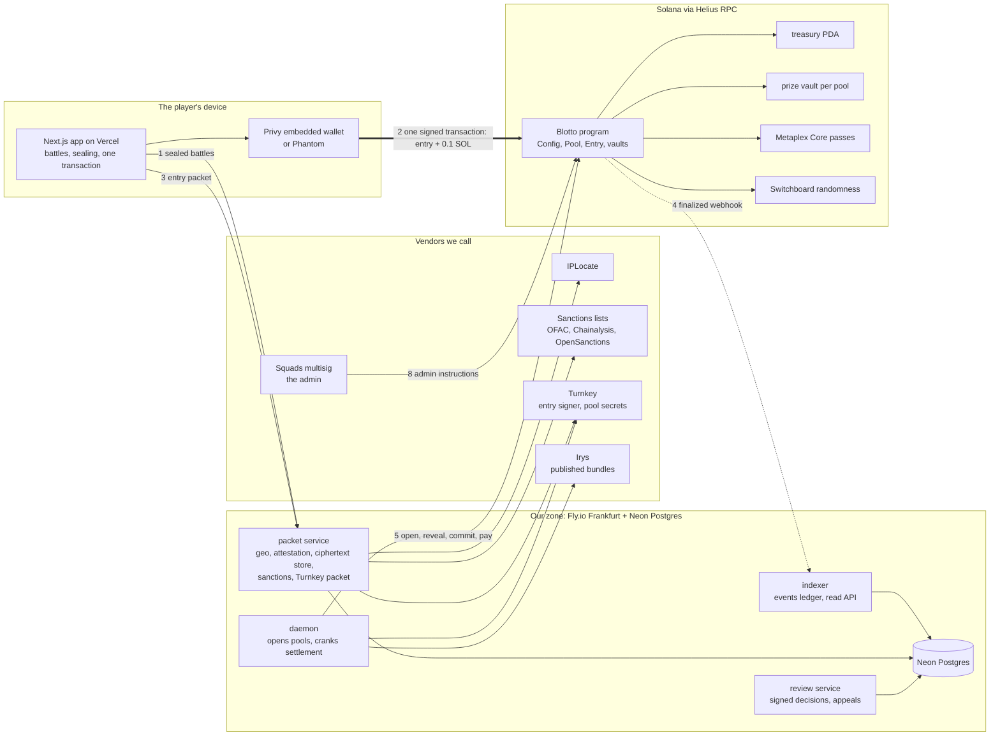
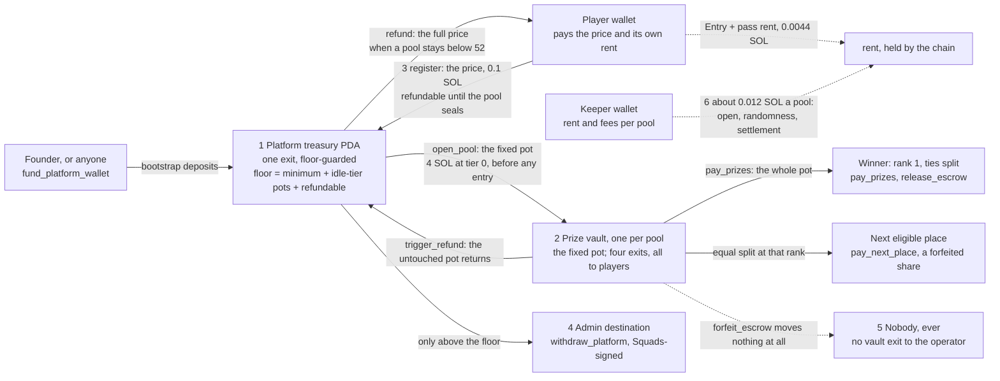
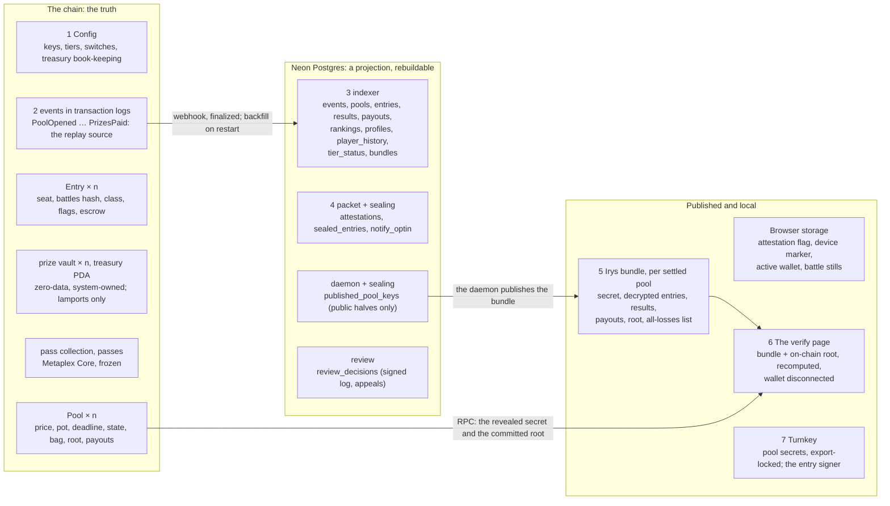
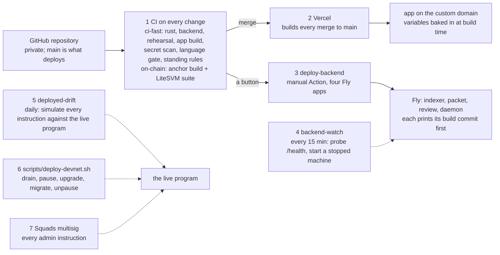

# Blotto Cup — architecture diagrams, annotated

Eight views of the system as it is built on the branch, drawn from the code and from `AS-BUILT.md`,
`OPERATING-MANUAL.md` and `hosting.md`. Each figure carries numbered notes; the numbers match the
callouts on the rendered page that accompanies this file. Constants live in the PID and the roadmap;
the vendor inventory and the cost forecast live in `INFRASTRUCTURE.md`. Nothing here is canonical
for a number: where a figure and `AS-BUILT.md` disagree, `AS-BUILT.md` is right and this file is
wrong.

Dated 2026-09-11, branch `claude/nice-turing-k0ipl5`.

---

## Figure 1 — Trust boundaries

Three zones. The entry payment leaves the player's wallet and reaches the program without passing
through any service of ours. Our services authorise, relay, index and settle. The chain holds the
money.



1. **Sealing happens on the device.** The seven battles are encrypted in the browser to the pool's
   public key before anything is paid. Only their hash goes on chain, and the ciphertext is stored
   where nothing can read it until the pool closes.
2. **The payment never enters our zone.** The wallet signs one transaction that both records the
   entry and moves 0.1 SOL to the treasury PDA. The packet service can refuse an entry. It cannot
   take money.
3. **The packet service is the gate and it fails closed.** Territory, VPN, sanctions and the signed
   18+/terms statement are checked, then Turnkey signs a packet the program insists on. No vendor
   answer means no entry.
4. **The indexer is a projection.** It ingests finalized program events by webhook, rebuilds from RPC
   on restart, and serves every read the pages make. Losing it loses nothing.
5. **The daemon is the only thing that opens pools** (the program accepts no other key) and the
   crank that settles them. Sealing and refunding an existing pool stay permissionless, so a dead
   daemon strands nothing.
6. **The program holds every lamport** in two kinds of account: one treasury PDA and one prize vault
   per pool. A vault has exactly four exits and all of them end at a player.
7. **Turnkey holds two secrets on our behalf:** the entry signer, which can only sign packets, and
   each pool's sealing secret, export-locked by a policy that reads chain state.
8. **Squads is the admin.** Every admin instruction is a multisig transaction the founder approves.
   On devnet the threshold is one.
9. **Irys is where results are published** so that the verify page, and anyone else, can recompute a
   pool without asking us.

---

## Figure 2 — The entry path

One entry, in order, across five lanes. Reading down the Browser lane shows what the player
experiences. Reading across shows which party answers each step.

```mermaid
sequenceDiagram
  autonumber
  participant B as Browser
  participant W as Wallet
  participant P as Packet service
  participant V as Vendors
  participant C as Chain via Helius
  B->>P: GET /geo
  P->>V: IPLocate: territory, VPN
  P-->>B: allowed, or refused with a re-check
  B->>W: sign the 18+ and terms statement
  B->>P: POST /attestation (stored per wallet and terms version)
  B->>C: balance ≥ price + 0.01 SOL
  Note over B: seven battles, 15 s each; five u8 summing to 100
  Note over B: 127-byte payload sealed to the pool's X25519 key; commitment = sha256(battles ‖ salt)
  B->>P: POST /ciphertexts (before any money)
  B->>P: POST /packet
  P->>V: IPLocate again; OFAC, Chainalysis, OpenSanctions; attestation on record
  P->>V: Turnkey signs the 85-byte packet (60 s to use it)
  P-->>B: packet + Ed25519 instruction
  B->>C: simulateTransaction (compute budget, low balance, refused pool)
  B->>W: sign
  Note over B: the fresh pass keypair co-signs locally
  B->>C: sendTransaction, then poll to "confirmed"
  Note over C: register: verify packet, move 0.1 SOL to the treasury, draw the class, mint the frozen pass, emit EntryRegistered; the 64th seat seals
  C-->>B: the landed transaction's own event: class, seat, pass
  C-->>P: finalized webhook to the indexer a few seconds later
```

1. **Availability first.** Nothing that can take money renders until the packet service says the
   player's location is allowed. A slow or failed lookup is a refusal, with a re-check offered.
2. **The clickwrap is a signature.** The wallet signs a canonical 18+ and terms statement. The
   service stores it per wallet and terms version, and re-prompts every wallet when the version
   changes.
3. **The balance gate** runs before the ninety seconds start, so a wallet that cannot cover the price
   plus rent and fees never plays a timer it cannot finish.
4. **Seven battles, fifteen seconds each.** Five integers summing to exactly 100 is enforced by the
   client before anything leaves it. An unlocked battle is entered as the even split.
5. **Sealing.** Battles (35 bytes), a random salt (32), the per-battle timings (28) and a device
   marker (32) form a 127-byte payload, sealed to the pool's X25519 key. The commitment is
   sha256(battles ‖ salt).
6. **Ciphertext before money.** The sealed payload is stored first so a paid entry can never be one
   whose ciphertext was lost.
7. **The packet.** Territory and VPN again, the sanctions lists, and the attestation on record. Then
   Turnkey signs 85 bytes naming the wallet, the pool, a nonce, the cleared flags, the issue time and
   the terms version. The program accepts it for 60 seconds.
8. **Simulation before signature.** The transaction is simulated to size its compute budget and to
   surface low balance or a refused pool before the wallet prompt appears.
9. **Two signatures.** The wallet signs first. The fresh pass-asset keypair co-signs locally
   afterwards, because Metaplex Core requires the new asset's signature.
10. **One transaction does everything.** The program reads the Ed25519 instruction from the sysvar and
    binds it to this wallet and pool, moves the price to the treasury PDA, draws the cosmetic class
    from a delayed slot hash and the pool's randomness, mints the frozen pass, and emits the event.
    The 64th entry seals the pool in the same call.
11. **Confirmed means the chain said so.** The browser reads the landed transaction's own event for
    the class, seat and pass. If the logs cannot be read it shows a recovery state, never a guess
    and never a retry.
12. **The indexer catches up** on the finalized event a few seconds later, and the pool page shows
    the seat.

---

## Figure 3 — The pool's life

Six states and the instructions that move a pool between them. The operator has no say over which
fork a pool takes: the deadline, the field and the clock decide.

```mermaid
stateDiagram-v2
  [*] --> Open: keeper open_pool (1)<br/>pot moves treasury to vault, sealing key, 12 h clock
  Open --> Sealed: 64th register, or seal_at_deadline with ≥ 52 (2)
  Sealed --> Scored: reveal_pool_secret then commit_results (3)
  Scored --> Paid: pay_prizes, batched; flagged or held shares escrowed (4)
  Open --> Refunding: trigger_refund, anyone, < 52 at 12 h (5)<br/>the untouched pot returns to the treasury
  Open --> Closed: 0 entrants at the deadline
  Refunding --> Closed: refund × n, anyone, the full price from the treasury
  Paid --> [*]: a held share (6): release at 12 h or by anyone at 7 days; forfeit then pay_next_place; sanctions hold lifted by admin only
  Closed --> [*]
  note right of Paid: tier slot frees, 5-minute cooldown, the keeper opens the next pool (7)
```



1. **Opening funds the pot first.** The keeper moves the tier's fixed pot from the treasury into the
   new pool's vault before a single entry exists, generates the pool's sealing key, and stamps a
   12-hour deadline that is never rewritten.
2. **Two ways to seal.** The 64th entry seals in the same transaction. At the deadline anyone may
   seal a pool holding at least 52. Sealing releases the pool's entry payments from the refundable
   floor: from here refunds are impossible and the money is revenue.
3. **Reveal then commit.** The settlement signer publishes the secret, hash-checked against the
   commitment made at open, then commits the results root and the payout list, which the program
   checks sums exactly to the pot.
4. **Paying is batched and idempotent.** Each committed seat is paid once. A flagged or
   sanctions-held seat is escrowed instead of sent. All seats settled means Paid.
5. **The refund fork.** Below 52 at the deadline anyone may trigger the refund: the untouched pot
   returns to the treasury, then each entry is repaid in full from the treasury, permissionlessly,
   until Closed.
6. **A held share has no door to us.** A flag is released by review, by the daemon's 12-hour clock,
   or by anyone after seven days. An upheld flag is paid onward to the next eligible place, equally
   split. A sanctions hold moves only when the admin lifts it.
7. **Sequential pools per tier.** The tier's slot frees only at Paid or Closed, a five-minute
   cooldown follows, and the keeper opens the next pool when the treasury policy allows it.

---

## Figure 4 — Settlement

The daemon ticks every fifteen seconds through three phases. The crank is the SETTLE phase's work on
one sealed pool, and every step re-reads the chain so a crash resumes rather than repeats.

```mermaid
flowchart LR
  TICK["every 15 s:<br/>SETTLE, then KEEP, then OPEN"]
  S1["1 export the secret<br/>Turnkey policy: Sealed or past deadline"]
  S2["2 reveal_pool_secret<br/>on chain, hash-checked"]
  S3["3 decrypt and verify<br/>each entry against its commitment;<br/>failures scored all losses"]
  S4["4 score<br/>identical field, half-points as integers"]
  S5["5 rank and split<br/>battles won, then stats won"]
  S6["6 results tree<br/>leaf = player ‖ rank ‖ amount"]
  S7["7 publish the bundle<br/>Irys"]
  S8["8 detection report<br/>advisory, logged"]
  S9["9 screen winners<br/>sanctions match places a hold"]
  S10["10 commit_results<br/>root + payouts, sum = pot"]
  S11["11 pay_prizes<br/>batched; escrow for flagged or held"]
  S12["12 onward<br/>slot frees, cooldown, next pool"]
  TICK --> S1 --> S2 --> S3 --> S4 --> S5 --> S6 --> S7 --> S8 --> S9 --> S10 --> S11 --> S12
```



1. **The secret leaves custody only now.** Turnkey's export is refused unless the pool is Sealed or
   past its deadline. The daemon does nothing when custody and the chain disagree.
2. **The reveal is on chain.** Anyone can fetch the secret from the pool account from this moment.
   The read API also starts serving the ciphertexts.
3. **Every entry is checked against its own commitment.** A missing ciphertext, a failed decryption,
   a hash mismatch or a malformed battle set is scored all losses by a published rule and named in
   the bundle. One bad entry never halts a pool.
4. **Identical-field scoring.** Battle k is compared with every other entry's battle k: three of five
   stats wins, otherwise a draw worth half a win to each, carried as integer half-points.
5. **Ranking and the split.** Battles won, then stats won. Players equal on both share a rank and
   split the prize of the positions they occupy. The whole pot goes to rank 1.
6. **The results tree.** One leaf per seat, player ‖ rank ‖ amount, domain-separated sha256. The root
   is what the chain commits and what a player recomputes.
7. **Publication.** The bundle carries the secret, every decrypted entry, the results, the payouts
   and the root, on Irys, so it outlives us.
8. **Detection is advisory.** Five signals run on every pool and their report is logged. A flag is a
   signed human decision on the review desk, never the daemon's.
9. **Winner screening.** Every wallet in the payout list is checked against the sanctions lists. A
   match, or a screening that cannot answer, places an on-chain hold before anything is committed.
10. **Commit.** The root and the payout list go on chain. The program refuses a list that is
    unsorted, duplicated, out of range or does not sum to the pot.
11. **Pay.** Vault to winner, batched. A flagged or held seat's share stays in the vault as escrow.
    The vault reads zero when the pot has fully left it.
12. **Onward.** The tier's slot frees, the cooldown runs, and the OPEN phase funds the next pot from
    the treasury if the policy floor allows, with a fresh sealing key imported to Turnkey, a fresh
    Switchboard randomness account and a fresh pass collection.

---

## Figure 5 — The money model

Every lamport movement the program can make. Solid arrows are the fixed, published amounts. Dashed
arrows are rent and fees. There is no arrow from a prize vault to the operator because no
instruction draws one.



1. **The treasury PDA** receives 100% of every entry and funds every pot. Its one exit is
   admin-gated and refused below a floor the program computes: the minimum balance, plus one further
   pot for every idle enabled tier, plus every entry that can still be refunded.
2. **A prize vault** holds exactly the pot from the moment the pool opens. Its four exits,
   `pay_prizes`, `release_escrow`, `pay_next_place` and the refund fork's pot return, are pinned by
   a CI check that fails on any other transfer.
3. **An entry is refundable until seal.** The program tracks the sum on Config. A withdrawal cannot
   dip into it, so a refund is program-held money and not an operator promise.
4. **Withdrawal is the only way anything reaches us,** and only from the treasury, only above the
   floor, only signed by the Squads vault, and always emitted as an event the treasury report
   replays.
5. **A forfeited share moves nothing.** It stays in its pool's vault until it is divided equally
   among the eligible players at the rank it passes to. The settlement key cannot route it to
   itself, and the four service keys can never hold a seat.
6. **The operator's own costs** are rent and fees the keeper wallet pays per pool, about 0.012 SOL
   measured on devnet. The player pays the rent of their own Entry account and pass.

---

## Figure 6 — Keys and what each may do

Drawn as a table because the mechanism is a list of permissions, and the program enforces it: every
privileged instruction checks its signer, and `register` refuses all four service keys.

| Key | Held by, today | Can | Cannot | Before mainnet |
|---|---|---|---|---|
| Admin | The Squads vault `9EEWtz…`; the founder's Phantom approves each transaction | Pause entries, set tiers and prices for future pools, the treasury policy, withdraw above the floor, record an upheld flag (forfeit), lift a sanctions hold | Reach a prize vault; shorten a live pool; enter a pool | Also take the upgrade authority |
| Upgrade authority | A single devnet fee payer `GXKXLY…` | Replace the program | (nothing else) | Move to the Squads vault (audit O5) |
| Keeper = settlement signer | One keypair `EaDfwM…`, decoded into tmpfs at boot on the daemon and the review service | Open pools (the program's gates decide whether), reveal, commit, pay, flag, clear, release, pay onward, place a sanctions hold | Withdraw anything, forfeit, enter a pool, pay itself | Split the two keys; Turnkey co-signing (audit O6) |
| Entry signer | Turnkey, sign-only, non-exportable `9XhwKr…` | Sign entry packets | Move money; enter a pool | Unchanged |
| Pool secrets | Generated in the daemon, imported to Turnkey, wiped locally; export-locked until Sealed or past the deadline | Decrypt a pool's entries after it closes | Leave custody early (the policy reads chain state) | Assert the policy against the real API (O7); custody-side generation is the open risk |
| Irys upload wallet | The daemon `HG56vM…` | Pay for bundle publishing | Anything on the program | Unchanged |
| Reviewer | The founder's wallet `4ydbVZ…`, the only registry member | Sign a review decision; decide an appeal lodged against someone else's decision | Move money: a decision is executed by the settlement key, and forfeit by the admin | A second member (O24) |
| Player wallet | Privy embedded, or Phantom | Pay an entry, receive a prize or refund, sign the attestation and the appeal | Enter with one of the four service keys; the program refuses them | (no change planned) |

---

## Figure 7 — Where the data lives

The chain is the only truth. Postgres is a projection any restart rebuilds from RPC. The Irys bundle
is published evidence. The browser keeps only conveniences.



1. **On chain:** one Config, one Pool and one vault per pool, one Entry and one pass per seat, the
   treasury PDA, and the events in transaction logs that every off-chain number is replayed from.
2. **Into Postgres** by Helius webhook at finalized commitment, with a backfill from RPC on every
   restart, so a dropped delivery is caught.
3. **The indexer's tables** are the events ledger and the derived views the read API serves: pools,
   entries, results, payouts, rankings, profiles, player history, tier status, and the verified
   archive of bundles.
4. **The packet service's tables** hold the signed attestations, the email opt-ins and the sealed
   ciphertexts. The ciphertexts are served only after the pool's secret is on chain.
5. **The bundle** is the published record of a settled pool, addressed by content on Irys: the
   secret, every decrypted entry, the results, the payouts, the root, and the list of entries scored
   all losses.
6. **The verify page** needs no service of ours: it fetches the bundle and reads the revealed secret
   and committed root from RPC, decrypts, scores, rebuilds the tree and compares, with the wallet
   disconnected.
7. **Turnkey** holds the only copy of each pool's sealing secret and the entry signer. Postgres holds
   only the public halves.

---

## Figure 8 — Deploying and operating

How a change reaches players and how the running system is watched.



1. **Every change runs the full gate:** Rust format, lint and unit tests including the vault fuzz;
   backend type-check and tests; the offline twenty-pool rehearsal; the app's lint, type-check,
   tests and production build; a secret scan; the language gate; the standing-rules check. Program
   changes also build the artifact and run the LiteSVM suite against it.
2. **The frontend deploys itself:** Vercel builds every merge to main. Its variables are baked in at
   build time, so a changed setting needs a redeploy.
3. **The backend deploys by hand,** deliberately: a manual Action stages secrets from GitHub, refuses
   a mainnet-looking RPC, deploys the four Fly apps, and prints which signer and randomness source
   each service chose.
4. **backend-watch** probes the indexer and packet health endpoints every fifteen minutes and starts
   a machine that stopped, the failure a credential rotation can cause silently.
5. **deployed-drift** simulates every instruction against the live program daily and fails on a
   wire-contract mismatch, the failure that once left devnet nine days stale.
6. **A program upgrade** is a sequenced window: drain every pool to Paid or Closed, pause entries,
   upgrade, migrate any grown account in the same window, unpause. Pausing blocks new entries only.
   Settlement and refunds keep running.
7. **Admin instructions** go through Squads: the founder approves each one from Phantom, and the
   operating manual's rule is that the architect prepares and never sends.
