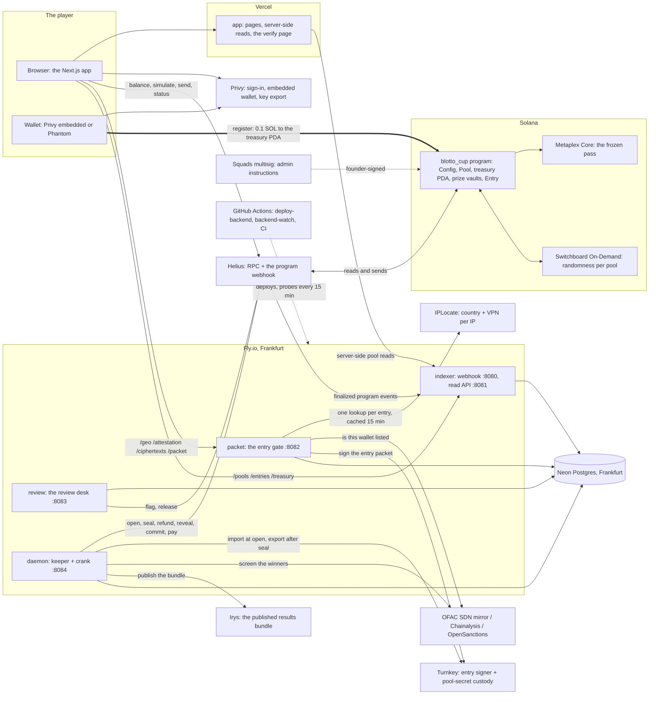

# Blotto Cup — infrastructure map and running costs

**What this document is.** The inventory of everything Blotto Cup runs on
outside this repository — the hosts, the database, the sign-in provider, the
RPC provider, the gate vendors, the custody, the storage and the chain itself
— with what each one does, what it talks to, how it fails, how it bills, and
a forecast of the monthly bill at five sizes. It is the canonical home for
*which vendor does what and what it costs*. `hosting.md` stays canonical for
the topology detail (ports, health checks, the webhook settings),
`go-live-devnet.md` for the founder's dashboard settings, and
`OPERATING-MANUAL.md` §8 for who holds which key.

**Currency of the numbers.** Vendor prices were read from the vendors' own
pricing pages on 2026-09-11; on-chain costs were measured on devnet the same
day from the keeper wallet's and a player wallet's transaction history. Every
figure in the forecast is an estimate under the assumptions in §4 — the
assumptions are the part to argue with, and each line names the driver that
would move it.

---

## 1. The map

The thick arrow is the entry payment. It goes from the player's wallet to the
platform treasury PDA inside one on-chain transaction and no service of ours
is on that path: the packet service authorises the entry, Helius relays the
transaction, the program moves the lamports. Everything else on the map is
either a read, an authorisation, or the operator's own money (rent and fees
paid by the keeper wallet).

## 2. Who does what

| Piece | Job | Talks to | Configured by | When it fails | How it bills |
|---|---|---|---|---|---|
| **Vercel** | Hosts the Next.js app (`app/`); builds `main` on every merge; server-side reads of the indexer; the verify page runs the scoring engine in the browser | Browser; indexer | Vercel project settings (Root Directory `app`, the `NEXT_PUBLIC_*` variables in `go-live-devnet.md` §3) | The site is down; nothing on chain or in the services changes | Hobby is free but non-commercial; Pro $20 per seat per month with 1 TB of transfer, then $0.15/GB |
| **Privy** | Sign-in (Google, X; Apple off), the embedded Solana wallet made at a social sign-in, Phantom sign-in through sign-in-with-Solana, key export. Funding is switched off | Browser only (`app/src/wallet/privy-bridge.tsx`) | `NEXT_PUBLIC_PRIVY_APP_ID`, allowed domains in the Privy dashboard | Sign-in goes inert; the site still renders | Free to 499 monthly active users (MAU); $299 at 500–2,499; $499 at 2,500–9,999; $2,000 base at 10,000 plus $0.05 per MAU above; 50,000 signatures a month included |
| **Helius** | The RPC every read and send goes through (browser, daemon, review, the indexer's backfill) and the webhook that pushes finalized program transactions to the indexer | Browser; Fly services; Solana | `NEXT_PUBLIC_SOLANA_RPC_URL`, `BLOTTO_DEVNET_RPC_URL`, `BLOTTO_HELIUS_WEBHOOK_SECRET` | The browser cannot read a balance or send; the daemon stalls (health `at` goes stale); the indexer rebuilds from RPC on restart | Free: 1M credits and 10 requests per second; Developer $49: 10M and 50 rps; Business $499: 100M and 200 rps; $5 per extra 1M |
| **Fly.io** | Four machines in Frankfurt: indexer (512 MB), packet (1 GB), review (512 MB), daemon (1 GB); one app each, deployed by the deploy-backend Action, probed every 15 min by backend-watch | Neon; Helius; the vendors below | `deploy/fly/*.fly.toml`; secrets set by the deploy workflow | Each service fails closed on its own (see `hosting.md`) | Per second: about $3.32 a month for a 512 MB shared-cpu-1x and $5.92 for 1 GB; egress $0.02/GB in Europe |
| **Neon** | Postgres in Frankfurt: the events ledger and projections (indexer), attestations, notify preferences and ciphertexts (packet), the signed review log (review), the published pool keys (daemon) | Every Fly service | `BLOTTO_DATABASE_URL` | Every service degrades: the read API errors, packets refuse, ticks skip | Free: 100 compute-hours and 0.5 GB per project; Launch: $0.106 per compute-hour and $0.35 per GB-month |
| **IPLocate** | The country and VPN/proxy/Tor verdict per IP behind the territory gate (`backend/packet/src/geo-iplocate.ts`); one lookup per `/geo` and per `/packet`, with a 15-minute per-IP cache | Packet service | `GEO_VENDOR_URL`, `GEO_VENDOR_API_KEY` | Every entry is refused (fail-closed; a 429 is never retried) | 1,000 requests a day free; monthly plans from roughly $25 at 100,000 requests |
| **Sanctions sources** | The OFAC SDN list mirrored from the Treasury's Sanctions List Service (free, ~29 MB, refreshed on a schedule, refuses to answer past 36 h stale); the Chainalysis sanctions API (free; 5,000 requests per five minutes; key not yet issued); OpenSanctions (€0.10 per query; optional cross-check). Every entrant is screened at issuance and every committed winner at settlement | Packet service; daemon | `SANCTIONS_*` | No source configured: the service does not start; a source that cannot answer is disclosed in the verdict; at settlement an unanswerable screening holds the share | OFAC mirror and Chainalysis free; OpenSanctions €0.10 per query |
| **Turnkey** | The entry signer that signs every entry packet (Ed25519, non-exportable) and the custody of every pool's sealing secret (imported at open, export-locked until the pool seals or passes its deadline) | Packet service; daemon | `TURNKEY_*`, `ENTRY_SIGNER_*` | No packets, so no entries; a pool cannot be revealed, so settlement waits | Pay as you go: 25 free signatures a month, then $0.10 each, 1,000 free wallets; Pro $99 a month plus $0.05 per signature, 2,000 wallets; Enterprise as low as $0.0015 per signature |
| **Switchboard On-Demand** | One Randomness account per pool; the oracle's reveal is bundled with `commit_vrf_seed`; feeds the cosmetic class draw and nothing in scoring | Daemon (through Helius); the program | `SWITCHBOARD_QUEUE` | A pool cannot take entries until its seed is committed; the daemon retries | On-chain rent and fees paid by the keeper wallet: 0.0060 SOL per pool measured on devnet |
| **Metaplex Core** | The pass collection per pool and one frozen pass per entry | The program (CPI) | Pinned program address | Entries fail if the collection is missing (the daemon creates it at open) | The player pays the pass rent, 0.0018 SOL |
| **Irys** | The published results bundle per settled pool, addressed at `gateway.irys.xyz`; the verify page fetches it | Daemon | `IRYS_UPLOAD_KEY`, `IRYS_NETWORK` | Settlement still pays; the bundle is published on a later tick | $0.05 per GB with a $0.01 minimum per upload, paid in SOL from the upload wallet |
| **Squads** | The admin multisig (`9EL1m9…`, vault `9EEWtz…`): every admin instruction is a Squads transaction the founder's Phantom approves | The program | `config/custody.json` records it | Admin instructions cannot land; pools keep running | Transaction fees only |
| **Solana** | The program `5aawXay…XH17`, its PDAs, rent and fees. Players pay their own entry rent; the keeper wallet `EaDfwM…` pays every pool's opening, randomness, collection and settlement transactions; the Irys wallet pays uploads | Everything above | `declare_id!` is the authority; nine further files and two vendor settings carry the id — the full list is `AS-BUILT.md` §3, pinned by a unit test | — | Measured 0.0122 SOL per pool on devnet (§3) |
| **GitHub** | The private repository; CI on every merge (ci-fast, on-chain, app-test-signer); the manual deploy-backend; backend-watch every 15 minutes; deployed-drift and skill-evidence daily | Fly; the chain (drift check) | `.github/workflows/` | Nothing live changes; deploys and probes stop | 2,000 Linux minutes a month included on the Free plan; $0.006 per minute beyond |
| **Domain and DNS** | The custom domain in front of Vercel (registrar not recorded in this repository) | Vercel | Vercel → Domains | The Vercel address still works | About $15 a year |

Founder-owned files that the services read from the repository, not from a
vendor: `config/territories.json`, `config/terms.json`,
`config/reviewers.json`, `config/custody.json`.

Not on the map because not built: an email vendor for the notifications
opt-in (`notify_optin` is stored; nothing sends), a KYC provider (the switch
is 0), and a metrics backend (the Prometheus text endpoint exists; the sink
is the log).

## 3. What one entry and one pool cost

**Per entry, measured** (devnet, 2026-09-11, transaction `5udiN8v2…`): the
player pays **0.104436 SOL** — 0.1 entry to the treasury PDA, 0.002613 for
the Entry account's rent, 0.001808 for the pass's rent, 0.000015 in fees. On
the operator's side each entry costs one Turnkey signature, one IPLocate
lookup (two without the cache), one sanctions screening against free
sources, and roughly 60 Helius credits across the session (the balance poll
every 15 s while a page is open, the simulate, the send, the status polls).

**Per pool, measured** from the keeper wallet's six pools (2026-09-06 →
09-11): `open_pool` 0.004958 SOL (Pool account rent and fee); randomness
0.006009 (Switchboard's Randomness account, its lookup table and the commit)
plus 0.000005 for the bundled reveal; `create_pass_collection` 0.001184;
`seal_at_deadline` or `trigger_refund` 0.000005; reveal, commit and pay about
0.000015 together; refunds 0.000005 each. **About 0.0122 SOL per pool**, or
$1.22 at $100. The forecast uses 0.015 SOL to leave room for mainnet
priority fees. About half of it is the Switchboard account rent, which is
reclaimable if the accounts are closed after the reveal; the daemon does not
close them today.

## 4. The forecast

### Assumptions

- **SOL at $100.** Quotes on 2026-09-11 sat between $100 and $106.
- **A user is a monthly active player who signs in at least once.** Each
  plays **4 entries a month** (one pool a week), so entries = 4 × users and
  settled pools ≈ entries ÷ 60.
- **Half of players use the embedded wallet**, so their signatures count
  against Privy's allowance; the other half sign with Phantom.
- **4 sessions per user per month at ~60 RPC calls each** → 240 Helius
  credits per user, on top of the daemon's ~0.6M credits a month of ticking
  every 15 seconds.
- **3 landing-page visits per user per month at ~15 MB each.** The hero reel
  is 4–42 MB per visit depending on screen width and the preloader 2–4.5 MB;
  video is nine-tenths of the site's transfer.
- **Mainnet operation.** Today, on devnet, every vendor sits on its free
  tier and the chain costs nothing; the running bill is about $100 a month
  (Fly, Neon, Helius Developer, Actions).
- **The rent cushion priced at mainnet's rent parameters.** Every pool
  leaves a rent cushion in its vault that is never recovered, and it is not a
  fixed number: the program reads the network's rent-exempt minimum for an
  empty account at the moment the pool opens
  (`programs/blotto_cup/src/vault.rs:62`), so it follows that cluster's rent
  parameters — **890,880 lamports (0.00089088 SOL) under the standard
  parameters**, and 650,240 on devnet as of 2026-09-12, where the parameters
  differ. The Solana row below prices the standard figure, because this bill
  forecasts mainnet.
- **One tier open.** A pool that refunds costs the same to run as a pool
  that pays.

### The monthly bill (USD)

| Line | Driver | 100 users | 200 | 500 | 1,000 | 10,000 |
|---|---|---:|---:|---:|---:|---:|
| Fly.io — four machines, Frankfurt | fixed; a bigger indexer at 10k | 19 | 19 | 19 | 19 | 28 |
| Neon Postgres — Launch plan, 0.25 CU always on | fixed until the ledger grows | 20 | 20 | 20 | 20 | 60 |
| Vercel Pro — one seat | fixed; transfer inside 1 TB | 20 | 20 | 20 | 20 | 20 |
| Privy | MAU tiers | 0 | 0 | 299 | 299 | 2,000 |
| Helius | Developer, then Business for rate headroom | 49 | 49 | 49 | 49 | 499 |
| IPLocate | lookups per day | 0 | 0 | 0 | 0 | 30 |
| Turnkey — one signature per entry | entries (pay-as-you-go, then Pro) | 38 | 78 | 198 | 299 | 2,099 |
| Sanctions — OFAC mirror and Chainalysis | free | 0 | 0 | 0 | 0 | 0 |
| Irys — one bundle per pool | pools | 0.07 | 0.13 | 0.33 | 0.67 | 6.67 |
| Solana — 0.016 SOL per pool: 0.015 SOL of rent and fees the keeper pays, plus the 0.0009 SOL rent cushion the treasury leaves in every vault (never recovered — since 2026-09-12; the assumption above says which rent figure this uses and why) | pools | 11 | 21 | 53 | 107 | 1,067 |
| GitHub Actions — private-repository overage | fixed | 16 | 16 | 16 | 16 | 16 |
| Domain | fixed | 1.25 | 1.25 | 1.25 | 1.25 | 1.25 |
| **Total** | | **174** | **224** | **675** | **831** | **5,827** |
| Per user | | 1.74 | 1.12 | 1.35 | 0.83 | 0.58 |
| Entries / pools the row assumes | | 400 / 7 | 800 / 13 | 2,000 / 33 | 4,000 / 67 | 40,000 / 667 |

Against the margin — and read this row before the reassuring one below it.
**A pool's margin depends entirely on how full it gets, and since R7-b the
floor is exactly break-even.** The pot is forty entries' worth at every tier,
so a pool sealing at 40 seats returns nothing at all; margin is `1 − 40/seats`
of intake and reaches 2.4 SOL at tier 0 only in a *full* pool.

`CHANGE-2026-09-12_sim-report.md` measures what that means on realistic
arrival curves. Mean margin per pool at tier 0, by sustained attempts per
12 hours: **0.38 SOL at 40 · 1.24 at 55 · 1.85 at 64 · 2.40 at 100**. The
full-pool figure is the ceiling, not the expectation.

At $100/SOL and the full-pool ceiling, pools per month × $240 gives $1,680 /
$3,120 / $7,920 / $16,080 / $160,080, so the bill is 10 %, 7 %, 8 %, 5 % and
4 % of it. **At the 55-attempt rate the simulation treats as the point where
refunds fall below one in ten, that same margin is roughly half** — so halve
the coverage and read the bill as 20 %, 14 %, 16 %, 10 % and 8 %. Below that
arrival rate the infrastructure bill is not covered by pool margin at all,
and the shortfall is funded from the treasury like the pots are. The two
lines that scale with players — Privy and Turnkey — are none of the bill at
100 users and 71 % of it at 10,000.

Optional lines, not in the total:

- **OpenSanctions** at €0.10 per query: winners only is €1 to €67 a month
  across the five sizes; every entrant would be €40 to €4,000 — more than
  every other vendor combined at 10,000 users.
- **Email notifications** (not built; a Resend-class vendor): free to about
  3,000 emails a month, then about $20.
- **Apple sign-in**: an Apple developer account, $99 a year.

### Where the bill steps

In the order the founder reaches them:

1. **Vercel Hobby → Pro before the first real-money entry.** Hobby is for
   non-commercial use, and its 100 GB of transfer is spent by about 6,500
   landing visits. $20.
2. **Neon Free → Launch in the first month of real use.** Four always-on
   services keep the database awake, so the Free plan's 100 compute-hours
   are gone in about 17 days. About $20.
3. **Helius Developer from launch.** The Free plan's 10 requests per second
   is one full pool's worth of browsers arriving at once. $49.
4. **Turnkey from the 26th entry of every month.** $0.10 an entry on pay as
   you go; Pro ($99 + $0.05) is cheaper past about 2,000 entries a month;
   Enterprise pricing (as low as $0.0015) is the lever, worth asking for at
   about 1,000 users. Each pool's sealing secret is also one Turnkey
   "wallet": 1,000 are free (Pro: 2,000), so at 667 pools a month the
   allowance is spent in two months, and the pricing page names no
   per-wallet overage — confirm with Turnkey before then.
5. **Privy at 500 MAU** ($299), 2,500 ($499) and 10,000 ($2,000). Sign-ins
   count; visitors do not.
6. **IPLocate's 1,000 lookups a day.** At 4 entries per user that is about
   7,500 users, or sooner on a busy day — and a 429 refuses every entry
   until the daily reset.
7. **Solana at about $1.50 a pool.** At 10,000 users that is about $1,000 a
   month, of which about $400 is Switchboard account rent the daemon could
   reclaim by closing the accounts after the reveal.

### Not in the table

The one-off mainnet program deployment (rent for the program account, a few
SOL), counsel, a KYC provider if the switch is ever turned on, marketing, and
the founder's time.

## 5. Recommendations

1. Ask Turnkey for Enterprise pricing at about 1,000 users, or sooner if
   entries per user run above four.
2. Move the 15-minute health probe off GitHub Actions to an external uptime
   service (most probe every minute on a free tier). backend-watch alone is
   about 2,900 Actions minutes a month, more than the private repository's
   free allowance.
3. Keep OpenSanctions to the winners. Screening every entrant at €0.10 would
   be the largest line on the bill at 10,000 users.
4. Helius Developer from day one; Business when a pool's worth of browsers
   routinely lands inside the same minute.
5. Close the Switchboard randomness account and its lookup table after the
   reveal; it returns about 0.006 SOL per pool to the keeper.
6. Serve the 2160p hero reel only to screens that can show it, or cap it at
   1080p: transfer is the Vercel meter and video is nearly all of it.

## 6. Sources

- Fly.io pricing: https://fly.io/docs/about/pricing/
- Neon pricing: https://neon.com/pricing
- Vercel pricing: https://vercel.com/pricing
- Privy pricing: https://www.privy.io/pricing
- Helius pricing: https://www.helius.dev/pricing
- IPLocate pricing: https://www.iplocate.io/pricing
- Turnkey pricing: https://www.turnkey.com/pricing
- OpenSanctions API: https://www.opensanctions.org/api/
- GitHub Actions billing: https://docs.github.com/en/billing/managing-billing-for-your-products/about-billing-for-github-actions
- Irys: $0.05 per GB, $0.01 minimum, per the network's published rate
- Measured on devnet, 2026-09-11: player transaction
  `5udiN8v2TrMV6vXcHW4vH1xwx9v2VbXvvfsd7gfRXURTsDLahSrHVg2hhyi2B3Y11QgmRebUebVu43NFc8smUAi7`;
  keeper wallet `EaDfwMWwW712L4YgdhBgEqbzzpdVP17e5mvY9LPwjrSD`, pools 1–6.
