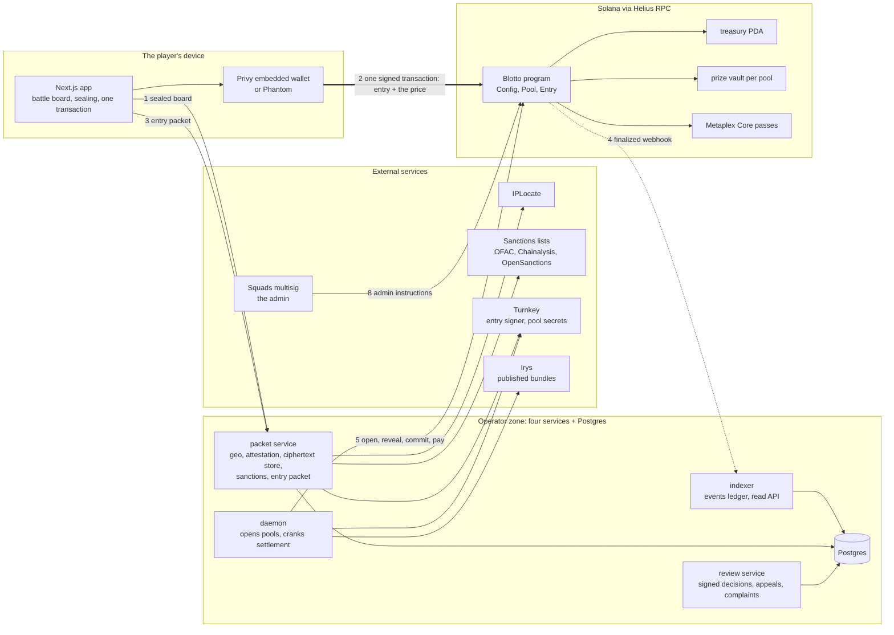
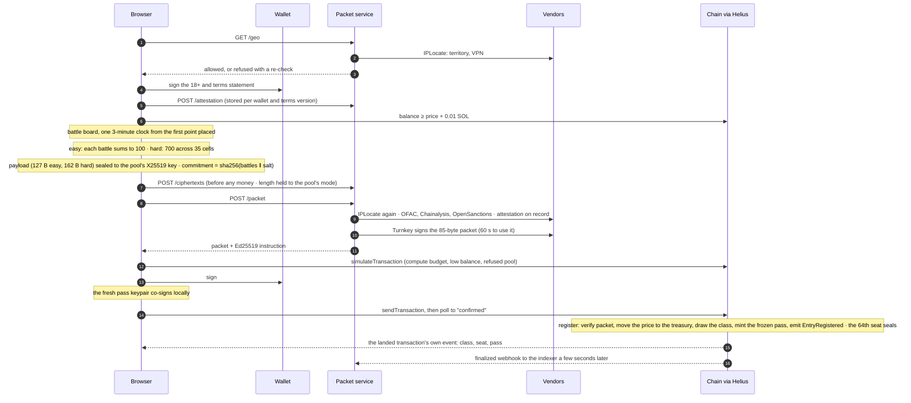
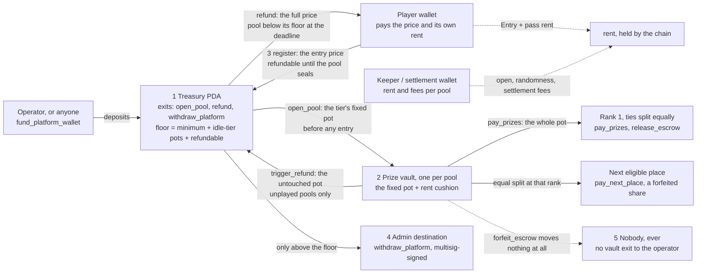
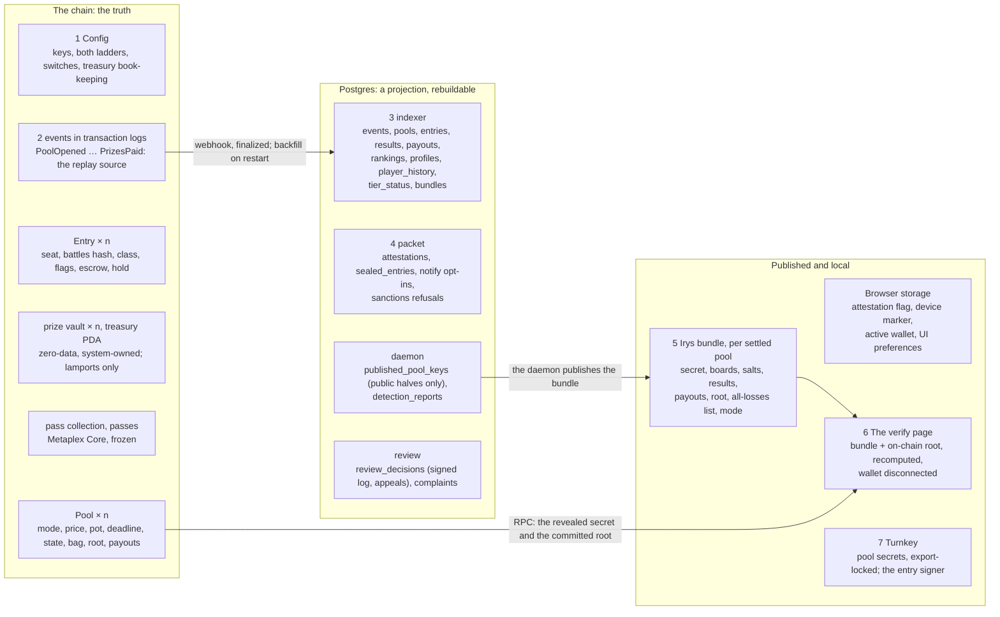
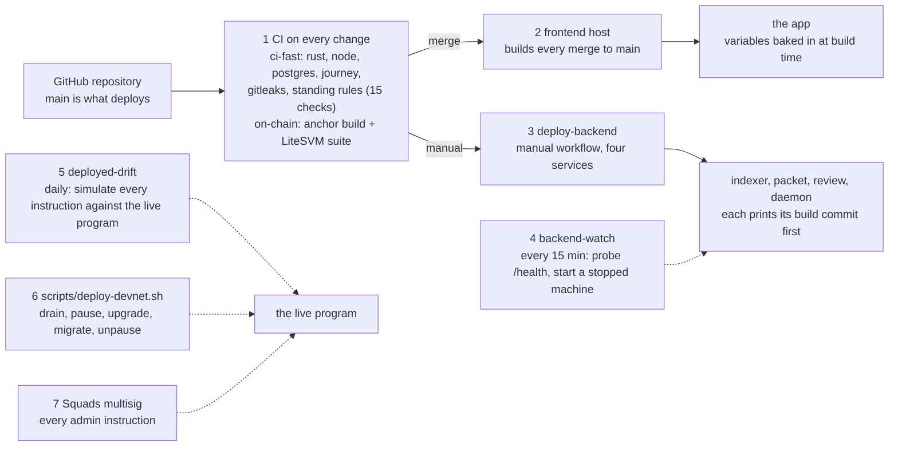

# Blotto Cup — architecture diagrams, annotated

Eight views of the system as built, drawn from the code and from [`ARCHITECTURE.md`](ARCHITECTURE.md).
Each figure is followed by numbered notes; where a figure carries a number in a label, the note
with that number explains it. Nothing here is canonical: where a figure and `ARCHITECTURE.md`
disagree, `ARCHITECTURE.md` is right. Hosting and vendor configuration live in
[`../guide/HOSTING.md`](../guide/HOSTING.md); operating procedures in
[`../guide/OPERATING-MANUAL.md`](../guide/OPERATING-MANUAL.md).

Devnet only; no real money.

---

## Figure 1 — Trust boundaries

Three zones. The entry payment leaves the player's wallet and reaches the program without passing
through any operator service. The operator's services authorise, relay, index and settle. The chain
holds the money.

1. **Sealing happens on the device.** The board is encrypted in the browser to the pool's public
   key before anything is paid. Only its hash goes on chain; the ciphertext is stored where nothing
   can read it until the pool closes.
2. **The payment never enters the operator zone.** The wallet signs one transaction that records the
   entry and moves the price to the treasury PDA. The packet service can refuse an entry; it cannot
   take money.
3. **The packet service is the gate and it fails closed.** Territory, VPN, sanctions and the signed
   18+/terms statement are checked, then Turnkey signs a packet the program insists on. No vendor
   answer means no entry.
4. **The indexer is a projection.** It ingests finalized program events by webhook, rebuilds from RPC
   on restart, and serves every read the pages make. Losing it loses nothing.
5. **The daemon is the only thing that opens pools** (the program accepts no other key) and the
   crank that settles them. Sealing and refunding an existing pool stay permissionless, so a stopped
   daemon strands nothing.
6. **The program holds every lamport** in two kinds of account: one treasury PDA and one prize vault
   per pool (Figure 5).
7. **Turnkey holds two kinds of secret:** the entry signer, which can only sign packets, and each
   pool's sealing secret, export-locked until the pool is sealed or past its deadline.
8. **Squads is the admin.** Every admin instruction is a multisig transaction (threshold one on
   devnet, disclosed in `config/custody.json`).
9. **Irys is where results are published**, so the verify page, and anyone else, can recompute a
   pool without asking the operator.

---

## Figure 2 — The entry path

One entry, in order, across five lanes.

1. **Availability first.** Nothing that can take money renders until the packet service says the
   player's location is allowed. A slow or failed lookup is a refusal, with a re-check offered.
2. **The clickwrap is a signature.** The wallet signs a canonical 18+ and terms statement, stored per
   wallet and terms version; every wallet is re-prompted when the version changes.
3. **The balance gate** runs before the board opens, so a wallet that cannot cover the price plus
   rent and fees never starts a clock it cannot finish.
4. **The board.** Seven fields, five stats each. One 3-minute clock, started by the first point
   placed. Unplaced points are spread evenly over unlocked fields on Submit or expiry. The client
   validates the finished board against the pool's rule before anything leaves it.
5. **Sealing.** Battles (35 bytes easy, 70 hard), a random salt (32), seven timing slots (28: each
   field's last-change time) and a device marker (32), sealed to the pool's X25519 key. The
   commitment is sha256 over the mode's encoding and the salt.
6. **Ciphertext before money.** The sealed payload is stored first, so a paid entry can never be one
   whose ciphertext was lost. A payload of the wrong mode's length is refused here.
7. **The packet.** Territory and VPN again, the sanctions lists, and the attestation on record. Then
   Turnkey signs 85 bytes naming the wallet, the pool, a nonce, the cleared flags, the issue time and
   the terms version. The program accepts it for 60 seconds.
8. **Simulation before signature.** Sizes the compute budget and surfaces low balance or a refused
   pool before the wallet prompt appears.
9. **Two signatures.** The wallet signs first; the fresh pass-asset keypair co-signs locally,
   because Metaplex Core requires the new asset's signature.
10. **One transaction does everything.** The program reads the Ed25519 instruction from the sysvar,
    binds it to this wallet and pool, moves the price to the treasury PDA, draws the cosmetic class,
    mints the frozen pass and emits the event. The 64th entry seals the pool in the same call.
11. **Confirmed means the chain said so.** The browser reads the landed transaction's own event. If
    the logs cannot be read it shows a recovery state, never a guess and never a retry.
12. **The indexer catches up** on the finalized event a few seconds later.

---

## Figure 3 — The pool's life

Six states and the instructions that move a pool between them. The operator has no say over which
fork a pool takes: the deadline, the field and the clock decide.

```mermaid
stateDiagram-v2
  [*] --> Open: keeper open_pool(mode) (1)<br/>pot + rent cushion moves treasury to vault, sealing key, 12 h clock
  Open --> Sealed: 64th register, or seal_at_deadline with ≥ min_seats (2)
  Sealed --> Scored: reveal_pool_secret then commit_results (3)
  Scored --> Paid: pay_prizes, batched; flagged or held shares escrowed (4)
  Open --> Refunding: trigger_refund, anyone, < min_seats past the deadline (5)<br/>the untouched pot returns to the treasury
  Open --> Closed: 0 entrants past the deadline
  Refunding --> Closed: refund × n, anyone, the full price from the treasury
  Paid --> [*]: a held share (6) · release at 12 h or by anyone at 7 days · forfeit then pay_next_place · sanctions hold lifted by admin only
  Closed --> [*]
  note right of Paid: the (mode, tier) slot frees, 5-minute cooldown, the keeper opens the next pool (7)
```

1. **Opening funds the pot first.** The keeper moves the tier's fixed pot, plus the vault's rent
   cushion, from the treasury into the new pool's vault before a single entry exists, publishes the
   pool's sealing public key and secret hash, records the mode (0 easy, 1 hard), and stamps a
   12-hour deadline that is never rewritten.
2. **Two ways to seal.** The 64th entry seals in the same transaction. Past the deadline anyone may
   seal a pool holding at least its own `min_seats` — 40 for every pool opened under R7-b, 52 for
   older pools, the figure each pool's players entered under. Sealing releases the pool's entry
   payments from the refundable floor.
3. **Reveal then commit.** The settlement signer publishes the secret, hash-checked against the
   commitment made at open, then commits the results root and the payout list, which the program
   checks sums exactly to the pot.
4. **Paying is batched and idempotent.** Each committed seat is paid once. A flagged or
   sanctions-held seat is escrowed instead of sent. All seats settled means Paid.
5. **The refund fork applies only to a pool that never played.** Below its floor past the deadline
   anyone may trigger the refund: the untouched pot returns to the treasury (the rent cushion stays),
   then each entry is repaid in full from the treasury, permissionlessly, until Closed.
6. **A held share has no door to the operator.** A flag is released by review, by the daemon's
   12-hour clock, or by anyone after seven days. An upheld flag is paid onward to the next eligible
   place, split equally. A sanctions hold moves only when the admin lifts it.
7. **Sequential pools per (mode, tier).** Each ladder has its own slot, switch and cooldown; the
   slot frees only at Paid or Closed, and the keeper opens the next pool when the treasury policy
   allows it. An easy and a hard pool can run side by side at the same tier.

---

## Figure 4 — Settlement

The daemon ticks every fifteen seconds through three phases. The crank is the SETTLE phase's work on
one sealed pool, and every step re-reads the chain so a crash resumes rather than repeats.

```mermaid
flowchart LR
  TICK["every 15 s:<br/>SETTLE, then KEEP, then OPEN"]
  S1["1 export the secret<br/>refused unless Sealed or past deadline"]
  S2["2 reveal_pool_secret<br/>on chain, hash-checked"]
  S3["3 decrypt by Pool.mode, verify<br/>each entry against its commitment;<br/>failures scored all losses"]
  S4["4 score<br/>identical field, half-points as integers"]
  S5["5 rank and split<br/>score, then stats won"]
  S6["6 results tree<br/>leaf = player ‖ rank ‖ amount"]
  S7["7 detection report<br/>advisory, persisted"]
  S8["8 screen winners<br/>match: hold · no answer: retry next tick"]
  S9["9 commit_results<br/>root + payouts, sum = pot"]
  S10["10 pay_prizes<br/>batched; escrow for flagged or held"]
  S11["11 publish the bundle<br/>Irys, version 3, names the mode"]
  S12["12 onward<br/>slot frees, cooldown, next pool"]
  TICK --> S1 --> S2 --> S3 --> S4 --> S5 --> S6 --> S7 --> S8 --> S9 --> S10 --> S11 --> S12
```

1. **The secret leaves custody only now.** Export is refused unless the pool is Sealed or past its
   deadline. The daemon does nothing when custody and the chain disagree.
2. **The reveal is on chain.** Anyone can read the secret from this moment. The read API serves no
   ciphertext; the published bundle is the only public copy of the boards.
3. **Every entry is checked against its own commitment**, decoded under the pool's mode. A missing
   ciphertext, failed decryption, wrong-length payload, hash mismatch or a board that breaks the
   pool's rule is scored all losses by a published rule and named in the bundle. One bad entry never
   halts a pool.
4. **Identical-field scoring, the same in both modes.** Battle k against every other entry's battle
   k: three of five stats wins, otherwise a draw; win 2, draw 1, loss 0 in integer half-points.
5. **Ranking and the split.** Score, then stats won. Players equal on both share a rank and split the
   pot equally if that rank is first.
6. **The results tree.** One leaf per seat, domain-separated sha256. The root is what the chain
   commits and what a player recomputes.
7. **Detection is advisory.** Five signals run on every pool and the report is persisted. A flag is
   a signed human decision on the review desk, never the daemon's.
8. **Winner screening.** Every wallet in the payout list is checked against the sanctions lists. A
   match places an on-chain hold before anything is committed. A screening that cannot answer places
   nothing: the crank refuses to commit and screens again on the next tick.
9. **Commit.** The root and the payout list go on chain. The program refuses a list that is
   unsorted, duplicated, out of range or does not sum to the pot.
10. **Pay.** Vault to winner, batched. A flagged or held seat's share stays in the vault as escrow.
11. **Publication, after the money.** The bundle carries the secret, every board and salt, the
    commitments and statuses, the results, the payouts and the root. Timings and device markers are
    never published. It runs last on purpose (`backend/reveal/src/crank.ts`): an upload that keeps
    failing must not hold a sealed pool's prize behind a storage vendor, so a bundle still owed is
    published on a later tick.
12. **Onward.** The slot frees, the cooldown runs, and the OPEN phase funds the next pot from the
    treasury if the policy floor allows, with a fresh sealing key, randomness account and pass
    collection.

---

## Figure 5 — The money model

Every lamport movement the program can make. Solid arrows move fixed, published amounts; dashed
arrows are rent and fees. There is no arrow from a prize vault to the operator because no
instruction draws one.

1. **The treasury PDA** receives every entry payment and funds every pot. Its exits are `open_pool`
   (into a vault), `refund` (to a player) and `withdraw_platform` (admin-gated, refused below a floor
   the program computes: the minimum balance, plus one reserved pot for every idle enabled tier on
   each ladder, plus every entry that can still be refunded).
2. **A prize vault** holds the pot from the moment the pool opens. Its exits are `pay_prizes`,
   `release_escrow`, `pay_next_place` and `trigger_refund`'s pot return, pinned function by function
   by `scripts/check-standing-rules.sh`. Once a pool plays, only the first three apply, and all three
   pay players.
3. **An entry is refundable until seal.** The program tracks the sum on `Config`; a withdrawal cannot
   dip into it, so a refund is program-held money rather than an operator promise.
4. **Withdrawal is the only way anything reaches the operator,** and only from the treasury, only
   above the floor, only signed by the multisig, always emitted as an event the treasury report
   replays.
5. **A forfeited share moves nothing.** It stays in its pool's vault until divided equally among the
   eligible players at the rank it passes to. The settlement key cannot route it to itself, and the
   four service keys can never hold a seat.

---

## Figure 6 — Keys and what each may do

Drawn as a table because the mechanism is a list of permissions, and the program enforces it: every
privileged instruction checks its signer, and `register` refuses all four service keys. The public
keys for each role are disclosed in `config/custody.json`.

| Key | Held as | Can | Cannot |
|---|---|---|---|
| Admin | A Squads multisig vault (threshold one on devnet) | Pause entries; set tiers, ladders and prices for future pools; set the treasury policy; withdraw above the floor; record an upheld flag (forfeit); lift a sanctions hold | Reach a prize vault; shorten a live pool; enter a pool |
| Upgrade authority | A single devnet key | Replace the program | Anything else |
| Keeper / settlement signer (one key on devnet) | A keypair loaded by the daemon and the review service | Open pools (the program's gates decide whether); reveal, commit, pay, flag, clear, release, pay onward; place a sanctions hold | Withdraw anything; forfeit; enter a pool; pay itself |
| Entry signer | Turnkey, sign-only, non-exportable | Sign entry packets | Move money; enter a pool |
| Pool secrets | Generated by the daemon, imported to Turnkey, local copy wiped | Decrypt a pool's boards after it closes | Leave custody before the pool is sealed or past its deadline |
| Irys upload wallet | The daemon | Pay for bundle publishing | Anything on the program |
| Reviewer keys (two, `config/reviewers.json`) | Registry members | Sign a review decision; decide an appeal against the other reviewer's decision; answer a complaint | Move money: decisions are executed by the settlement key, and a forfeit by the admin |
| Player wallet | Privy embedded, or Phantom | Pay an entry; receive a prize or refund; sign the attestation, an appeal or a complaint | Be one of the four service keys |

---

## Figure 7 — Where the data lives

The chain is the only truth. Postgres is a projection any restart rebuilds from RPC. The Irys bundle
is published evidence. The browser keeps only conveniences. What personal data is held and for how
long: [`../compliance/DATA-INVENTORY.md`](../compliance/DATA-INVENTORY.md).

1. **On chain:** one Config, one Pool and one vault per pool, one Entry and one pass per seat, the
   treasury PDA, and the events that every off-chain number is replayed from.
2. **Into Postgres** by webhook at finalized commitment, with a backfill from RPC on every restart,
   so a dropped delivery is caught.
3. **The indexer's tables** are the events ledger and the derived views the read API serves.
4. **The packet service's tables** hold the signed attestations, notification opt-ins, sanctions
   refusal records and the sealed ciphertexts. The ciphertexts are read by the daemon at settlement
   and served to nobody.
5. **The bundle** is the published record of a settled pool, addressed by content on Irys.
6. **The verify page** needs no operator service: it fetches the bundle, reads the revealed secret
   and committed root from RPC, decodes under the bundle's mode, scores, rebuilds the tree and
   compares, with the wallet disconnected.
7. **Turnkey** holds the only copy of each pool's sealing secret and the entry signer. Postgres holds
   only the public halves.

---

## Figure 8 — Deploying and operating

How a change reaches players and how the running system is watched.

1. **Every change runs the full gate:** Rust format, lint and unit tests including the vault fuzz;
   backend typecheck and tests; the offline twenty-pool rehearsal; migrations against Postgres; the
   app's lint, typecheck, tests, production build and browser journey; a secret scan; and the fifteen
   standing-rules checks. Program changes also build the artifact and run the LiteSVM suite.
2. **The frontend deploys itself** on every merge to main. Its variables are baked in at build time,
   so a changed setting needs a redeploy.
3. **The backend deploys by hand,** deliberately: a manual workflow stages secrets, refuses a
   mainnet-looking RPC, deploys the four services, and prints which signer and randomness source each
   service chose.
4. **backend-watch** probes the service health endpoints every fifteen minutes and starts a machine
   that stopped.
5. **deployed-drift** simulates every instruction against the live program daily and on program
   changes, and fails on a wire-contract mismatch between `main` and what is deployed.
6. **A program upgrade** is a sequenced window: drain every pool to Paid or Closed (the pre-flight
   refuses while any pool is Open), pause entries, upgrade, migrate any grown account in the same
   window, unpause. Pausing blocks new entries only; settlement and refunds keep running.
7. **Admin instructions** go through the multisig: each is a proposal its members approve.
